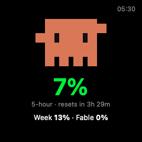
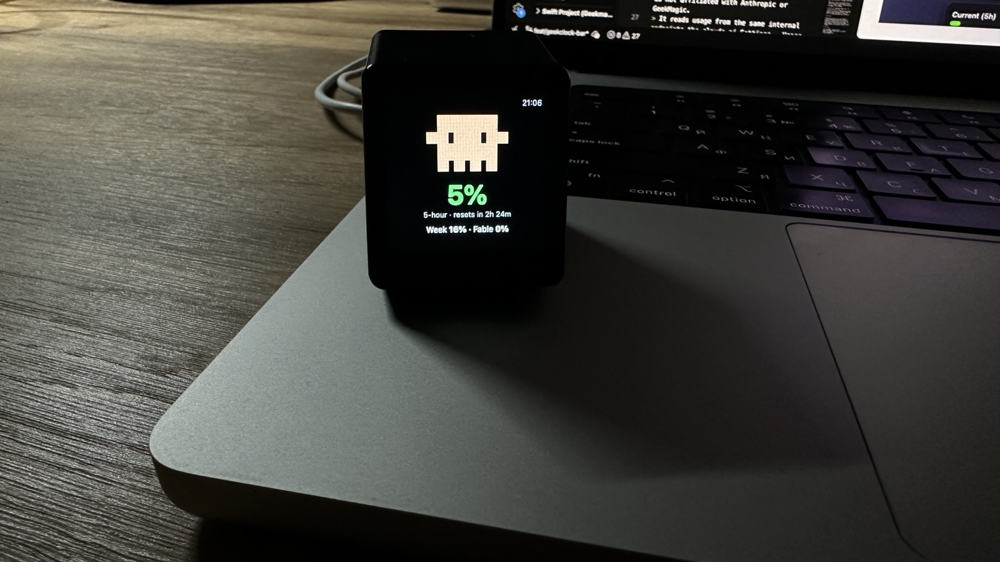
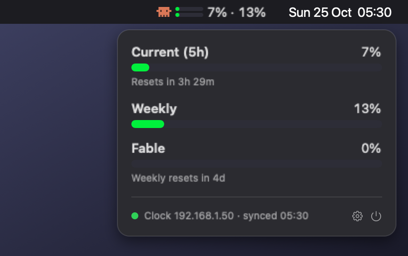
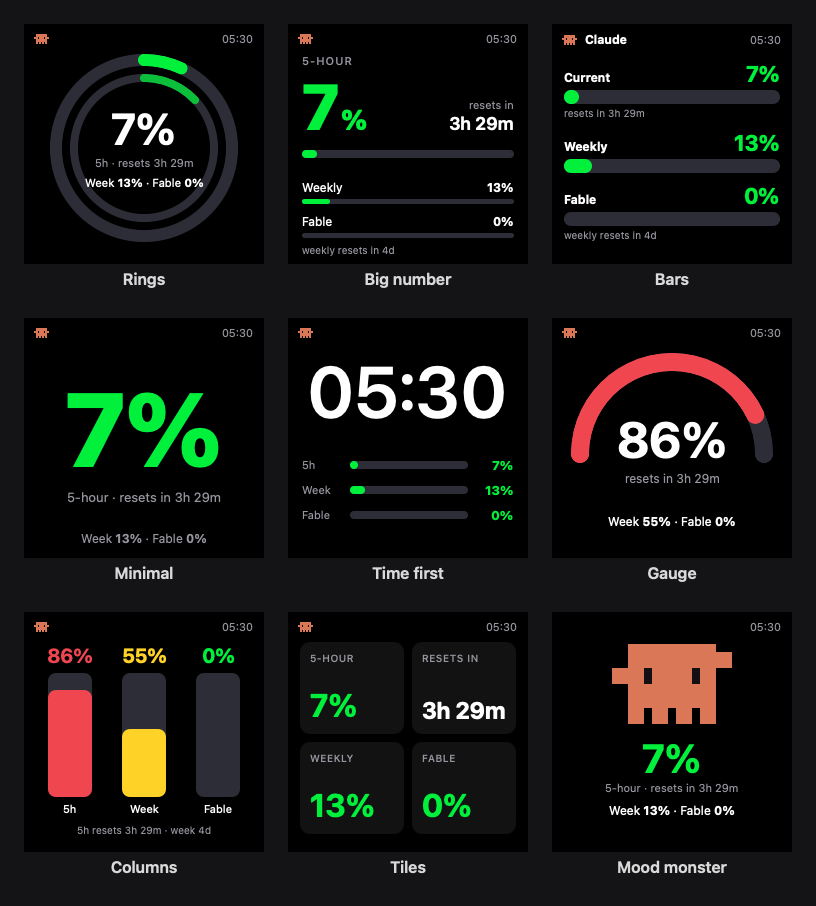
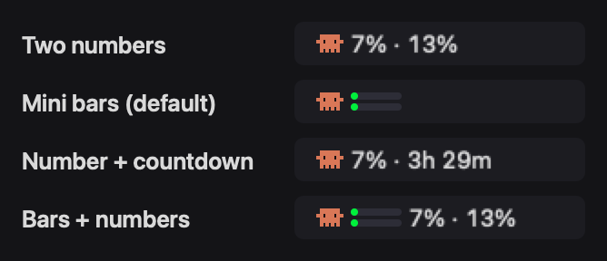
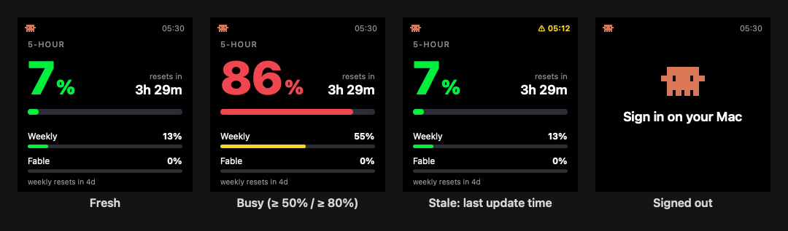

# GeekClock Bar

A macOS menu bar app that shows your **Claude usage limits** at a glance and mirrors
them to a [**GeekMagic SmallTV-Ultra**](https://geekmagic.cc/) desk clock. Sign in once inside the app; no cookies
to copy, no scripts to schedule.

<p align="center">
  
</p>

- **Menu bar:** a pixel monster plus your 5-hour and weekly usage, in one of four styles.
- **Panel:** click the item for the 5-hour, weekly and per-model limits, with reset countdowns.
- **Clock:** a 240×240 face pushed to the clock every minute. Nine designs, including an
  animated monster that does something different every minute.
- **Local:** runs entirely on your Mac. It talks to claude.ai and to your clock, nothing else.

On a real SmallTV-Ultra, with the Mood monster face:

<p align="center">
  
</p>

No clock? The menu bar item and panel work on their own:

<p align="center">
  
</p>



> [!NOTE]
> This is an unofficial hobby project. It is not affiliated with Anthropic or GeekMagic.
> It reads usage from the same internal endpoints the claude.ai Settings → Usage page uses.
> Those endpoints are undocumented and can change without notice.

## Contents

- [Requirements](#requirements)
- [Install](#install)
- [First run](#first-run)
- [Set up the clock](#set-up-the-clock)
- [Using it](#using-it)
- [How it works](#how-it-works)
- [Troubleshooting](#troubleshooting)
- [Uninstall](#uninstall)
- [Development](#development)
- [Credits](#credits)
- [License](#license)

## Requirements

- A Mac with **macOS 14 Sonoma** or later.
- **Swift 6:** either Xcode 16 or later, or just the Command Line Tools
  (`xcode-select --install`).
- A **claude.ai** account. The usage limits are those of Pro and Max plans.
- Optional: a **GeekMagic SmallTV-Ultra** ([geekmagic.cc](https://geekmagic.cc/)) on the
  same Wi-Fi as your Mac, running the stock firmware (tested with `Ultra-V9.0.43`).
  Firmware updates and manuals are in
  [GeekMagicClock/smalltv-ultra](https://github.com/GeekMagicClock/smalltv-ultra).
  Without a clock, the app works as a menu bar usage meter.

## Install

The app is built from source on your Mac, so it needs no notarization and Gatekeeper
won't block it.

```bash
git clone https://github.com/ixolt/geekclock-bar.git
cd geekclock-bar
scripts/build-app.sh
open ~/Applications/GeekClockBar.app
```

`scripts/build-app.sh` does the following:

1. Builds a release binary.
2. Wraps it into `GeekClockBar.app` with an ad-hoc signature.
3. Installs it to `~/Applications`.

If a copy is already running, the script quits it and replaces it. To update later,
`git pull` and run the script again.

## First run

1. **Sign in.** A "Sign in to Claude" window opens with the real claude.ai login page.
   Choose **Continue with email**, enter your address and type the code claude.ai
   emails you. The window closes by itself once you're in.

   > [!IMPORTANT]
   > **Continue with Google** and other single sign-on buttons don't work inside apps,
   > because Google blocks embedded browsers. If you normally use Google, choose
   > Continue with email and enter the same Gmail address. You land in the same account.

2. **Allow local network access** when macOS asks. The app needs it to reach the clock.

3. Your usage now shows in the menu bar. The session is kept between restarts, so you
   won't see the sign-in window again unless the session expires or you sign out.

## Set up the clock

1. **Find the clock's IP address.** The clock usually shows it on screen while it
   connects to Wi-Fi. You can also find it in your router's list of devices. Opening
   `http://<that address>` in a browser should show the clock's own settings page.
2. Click the menu bar item, then **⚙︎** (Settings).
3. Type the address, for example `192.168.1.50`, into **GeekMagic clock**, then click
   **Test**. You should see **✓ Clock updated**, and the clock switches to your usage.

Use the IP address rather than a host name.

What the app does to the clock:

- It uploads its picture as `/image/claude.jpg`, or as `claude.gif` for the animated face.
- It switches the clock to its **Photo Album** theme, showing that picture.
- It replaces the picture every minute, on the minute.

To give the clock back to its own themes, turn off **Send to clock** in Settings and
pick a theme on the clock's settings page.

## Using it

### Menu bar

Pick a style in **Settings → Appearance → Menu bar**:



| Style | Shows |
|---|---|
| Two numbers | monster, `7% · 13%` (5-hour · weekly) |
| Mini bars (default) | monster and two small bars: 5-hour on top, weekly below |
| Number + countdown | monster, `7% · 3h 29m` (5-hour and time to reset) |
| Bars + numbers | monster, both bars and `7% · 13%` |

The bars turn **green** below 50%, **yellow** from 50%, and **red** from 80%.
The icon fades when the numbers are more than 15 minutes old.

### Panel

Click the menu bar item to open the panel. It shows:

- **Current (5h)**, **Weekly**, and your per-model weekly limit (for example **Fable**),
  each with a bar and its reset countdown.
- A status line for the clock: its address, last sync, or the error.
- **⚙︎** opens Settings and **⏻** quits.

### Clock faces

Pick one in **Settings → Appearance → Clock face**. The preview under the picker shows
it with your live numbers.

| Face | Shows |
|---|---|
| Rings | 5-hour and weekly as two activity rings around the 5-hour % |
| Big number (default) | the 5-hour % large enough to read across the room, other limits as slim bars |
| Bars | three thick bars with coloured percentages |
| Minimal | only the 5-hour %, as big as it gets |
| Time first | a clock first, with three slim usage bars underneath |
| Gauge | the 5-hour limit as a speedometer dial |
| Columns | vertical bars that fill from the bottom |
| Tiles | a 2×2 grid: 5-hour, reset time, weekly, per-model |
| Mood monster (animated) | the monster up to something, with your numbers underneath |

Every face shows the same states:



- **Stale:** if the numbers couldn't be refreshed for 15 minutes, the time in the corner
  turns yellow and shows when they were last updated, for example `⚠ 05:12`.
- **Reset:** a limit whose reset time has passed shows `—` until fresh numbers arrive,
  never an out-of-date percentage.
- **Signed out:** when you're signed out, the clock says **Sign in on your Mac**.

### The mood monster

With the **Mood monster** face, the monster picks a new activity every minute, never the
same one twice in a row. It's always Claude orange. Your usage level shows in the colour
of the number under it.

- **Active:** waving, jumping, dancing, walking, looking around, falling asleep, love
  hearts.
- **Calm scenes:** watching TV, fishing, relaxing in sunglasses, thinking, coding,
  having coffee, reading.
- **Panic:** shaking with sweat drops, only possible once the 5-hour limit is at 80% or
  more.

The face is sent as a small looping GIF, a few KB to about 20 KB.

### Settings

| Setting | What it does |
|---|---|
| GeekMagic clock: IP address + **Test** | where to send the picture. Test uploads it and shows the result |
| Send to clock | turn clock updates on or off. The menu bar keeps working either way |
| Appearance: Menu bar / Clock face | the styles above, with a live preview of the face |
| Open at login | start with your Mac (on by default) |
| Claude account | who you're signed in as, and **Sign out** / **Sign in** |

## How it works

```
 claude.ai  ──(every 5 min, in a hidden web view)──▶  GeekClock Bar  ──(every minute, LAN HTTP)──▶  GeekMagic clock
                                                         │
                                                         └──▶ menu bar + panel
```

**Usage.** The app keeps a hidden web view signed in to claude.ai. Inside it, the app
calls `/api/organizations` and `/api/organizations/<id>/usage`, the same requests the
claude.ai usage page makes. Requests run in the page itself, so they carry your normal
browser session; the app never handles your password or cookies.

**When it fetches.** Every 5 minutes.

**The clock.** The app draws the face with SwiftUI at exactly 240×240 pixels and sends it
to the clock over its local HTTP API:

| Request | Purpose |
|---|---|
| `POST /doUpload?dir=/image/` | upload `claude.jpg` / `claude.gif` (multipart, field `file`) |
| `GET /set?img=%2Fimage%2F%2Fclaude.jpg` | select the picture |
| `GET /set?theme=3` | switch to the Photo Album theme |
| `GET /filelist?dir=/image/` | confirm an upload. The firmware answers uploads with a malformed header that macOS rejects, although the file is saved |

**Privacy.** Nothing is sent anywhere except claude.ai and your clock. The app keeps:

- **Settings and last numbers:** in the app's preferences, so the menu bar has something
  to show at launch.
- **claude.ai session:** in the app's own web data, separate from Safari.

## Troubleshooting

| Problem | Try |
|---|---|
| Google sign-in fails or does nothing | Use **Continue with email** with the same address (see [First run](#first-run)). |
| Clock shows **Sign in on your Mac** | Your claude.ai session expired or you signed out. Click **Sign in again** in the panel. |
| **Clock: Unreachable …** in the panel | Check that the Mac and clock are on the same network, and that `http://<clock IP>` opens in a browser. Check **System Settings → Privacy & Security → Local Network** and make sure GeekClock Bar is allowed. |
| Clock isn't showing the usage picture | Press **Test** in Settings. It re-selects the picture and switches to the Photo Album theme. |
| Yellow `⚠ 05:12` on the clock, faded icon | claude.ai couldn't be reached for 15+ minutes. The panel shows the error; it recovers by itself. |
| Some numbers show `—` | That limit has reset since the last successful refresh. Fresh numbers replace it within 5 minutes. |
| Numbers differ from claude.ai | They refresh every 5 minutes, so they can trail claude.ai by up to that long. |

## Uninstall

1. Click the menu bar item, then **⚙︎ → Sign out** (this clears the claude.ai session),
   then **⏻** to quit.
2. Delete the app and its data:

   ```bash
   rm -rf ~/Applications/GeekClockBar.app
   defaults delete com.alexpoliukh.geekclockbar
   rm -rf ~/Library/WebKit/com.alexpoliukh.geekclockbar \
          ~/Library/Caches/com.alexpoliukh.geekclockbar \
          ~/Library/HTTPStorages/com.alexpoliukh.geekclockbar*
   ```

3. If it still appears in **System Settings → General → Login Items**, remove it there.

## Development

```
Sources/
  GeekClockCore/     # everything testable: usage parsing and state, formatting, clock
                     # faces (SwiftUI) and rendering, the monster, the GeekMagic client
  GeekClockBar/      # the app: model and timer, claude.ai session, menu bar, panel, windows
Tests/GeekClockCoreTests/
Resources/Info.plist
scripts/
  build-app.sh       # build, wrap and install the .app
  test.sh            # run the tests
  readme-images.sh   # regenerate docs/images from the real renderer
```

Run the tests:

```bash
scripts/test.sh
```

The tests use [Swift Testing](https://github.com/swiftlang/swift-testing). With Xcode,
`scripts/test.sh` is plain `swift test`. With only the Command Line Tools, it also passes
the flag those tools need to find the Swift Testing macros.

The tests also render every face and state to `.build/previews/`, as PNGs, plus GIFs for
the monster. That's the quickest way to look at a design change without a clock.
`scripts/readme-images.sh` turns them into the images in this README.

**Forking?** The bundle identifier `com.alexpoliukh.geekclockbar` in
`Resources/Info.plist` names where the app keeps its settings and web data. Change it,
and the logger subsystem in `AppModel.swift`, if you distribute your own build.

## Credits

The SmallTV-Ultra clock and its firmware are made by [GeekMagic](https://geekmagic.cc/).
Their firmware releases and manuals are at
[GeekMagicClock/smalltv-ultra](https://github.com/GeekMagicClock/smalltv-ultra).

Inspired by [geekclock-claude](https://github.com/egerkuzma/geekclock-claude) by
egerkuzma, a Python script that does the same with a hand-copied session cookie. Its
pixel monster, colour levels and sample usage response are reused here under its MIT
licence.

## License

[MIT](LICENSE). Portions from geekclock-claude remain under its own MIT notice, included
in the LICENSE file.
